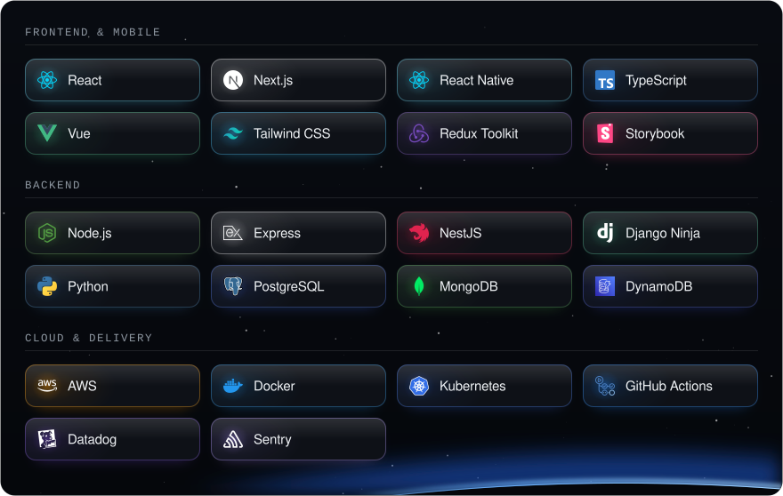

 

**Senior Software Engineer in São Paulo, Brazil.** I build web, mobile and cloud products with React, Next.js, Node, TypeScript and AWS.

## About

I build software that registry offices, banks and field teams rely on every day.

- **Now:** senior engineer at **Witek**, building for **ONR**, the national operator of Brazil's electronic property registration system, and **ON-RPCN**, which is digitizing birth, death and marriage records nationwide.
- **Before:** at **Banco Ourinvest** I helped take two applications from an empty repository to production, infrastructure included, and led the frontend team. At **Accenture** I was a key contributor to the refactor of Unilever's local sales app in React Native.
- **What I care about:** clean architecture, design systems in Storybook, trunk-based development with continuous delivery, and observability that guides product decisions.

## Tech stack

<picture>
  <source media="(prefers-color-scheme: dark)" srcset="assets/stack-dark.svg">
  <source media="(prefers-color-scheme: light)" srcset="assets/stack-light.svg">
  
</picture>

## Selected work

Most of my professional work ships in private client repositories, so the public projects below are the ones I can show. I'm glad to walk through the rest in an interview.

| Project | What it is | Built with |
| :-- | :-- | :-- |
| [**portfolio**](https://github.com/erickkarl/portfolio) · [live](https://erickkarl.dev) | My portfolio, art-directed as a view from orbit. Static export, scroll-driven motion, a component catalogue in Storybook and CI/CD to GitHub Pages. | Next.js 16, React 19, TypeScript, GSAP, Storybook, Vitest, GitHub Actions |
| [**The-Best-Birthday-Reminder**](https://github.com/erickkarl/The-Best-Birthday-Reminder) | Work in progress. A cross-platform birthday reminder as a TypeScript monorepo: Expo app, NestJS API, Supabase auth and Prisma over PostgreSQL. | Expo 54, NestJS 11, Prisma 7, Supabase, Turborepo, pnpm |
| [**pong-3d**](https://github.com/erickkarl/pong-3d) | Local two-player 3D pong with angle-based paddle hits, escalating ball speed and health bars. Component-based paddles and signal-driven scoring. | Godot 4.5, GDScript |
| [**HomeBoard**](https://github.com/erickkarl/dashmqtt-front) · [back end](https://github.com/erickkarl/dashmqtt-back) | 2021 IoT home-automation project: MQTT sensor readings stored in MongoDB, exposed by a REST API, and shown in a React dashboard with device control and alarms. | React, Material-UI, Node.js, Express, MQTT, MongoDB |

## Experience at a glance

| | Role | |
| :-- | :-- | :-- |
| **Witek** | Senior Software Engineer | May 2024 – now |
| **Banco Ourinvest** | Senior Frontend Developer, frontend tech lead | Mar 2022 – May 2024 |
| **Accenture** | React Native Developer (Unilever) | Oct 2021 – Mar 2022 |
| **UFBA** | B.Eng. in Electrical Engineering | 2015 – 2021 |

The full timeline is on [erickkarl.dev](https://erickkarl.dev#experience).

## Get in touch

The fastest way to reach me is [email](mailto:erickkarl5@gmail.com) or [LinkedIn](https://www.linkedin.com/in/erick-kva). I'm based in São Paulo and work remotely.
